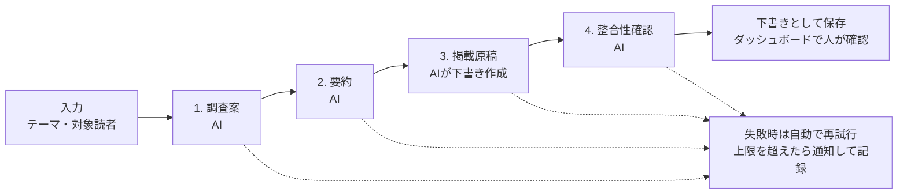

# AI社員タスクパイプライン

## このデモで分かること（発注者向け）

「AIに文章を作らせたいけれど、そのまま送ったり投稿したりするのは怖い」——その不安に応えるためのデモです。

- **AIが作るのは「下書き」まで**：完成した文章は自動で送信・投稿されず、下書きとして保存されます。実際に使う前に必ず人の目で確認できるので、誤送信・誤投稿が起きません。
- **担当を分けて品質を上げる**：「調べる」「要約する」「原稿を書く」「内容が食い違っていないか確認する」を別々のAI担当に分担させ、順番にバトンを渡します。一人で全部やらせるより、抜けや食い違いに気づきやすい構成です。
- **進み具合が見える**：処理の状態は一覧画面（ダッシュボード）で確認できます。「何件終わったか」「どこで失敗したか」が分かるので、ブラックボックスになりません。
- **失敗しても全体は止まらない**：うまくいかなかった処理は自動でやり直し、それでもダメなら通知します。他の処理はそのまま続行します。
- **費用をかけずに流れを試せる**：ダミーの応答で動かすモードがあり、AIへの通信・API課金なしで一連の流れを確認できます。

## 処理の流れ



ポイントは最後のステップです。**AIの仕事は「下書きを保存するところ」まで**で、その先（実際に送る・投稿する）は人が確認してから行います。

## 実務ではこう使う

この「入力 → AIが段階処理 → 下書き → 人が確認」という型は、文章を作る業務全般に応用できます。たとえば：

| 業務 | 4つの段階の割り当て例 |
| --- | --- |
| 問い合わせへの返信 | 内容の確認 → 要点の要約 → 返信文の下書き → 表現・事実関係のチェック |
| SNS・ブログ投稿 | ネタの整理 → 構成の要約 → 投稿文の下書き → 誤字・トーンのチェック |
| お客様レビューへの返信 | レビュー内容の確認 → 要点の要約 → 返信文の下書き → 不適切な表現がないかチェック |
| 報告書・議事メモ | 素材の整理 → 要約 → 報告書の下書き → 数字や固有名詞の食い違いチェック |

いずれも「AIが勝手に送る」のではなく、**下書きを人が承認してから使う**前提で設計します。このデモ自体も外部への投稿は行わず、成果物は下書きデータと確認用ダッシュボードまでで完結します。

## このデモは何か
調査案 → 要約 → 掲載原稿 → 整合性確認を、役割別のエージェントで順に処理するPythonの参照実装です。
SQLiteにタスクと試行履歴を保存し、静的HTMLで状態を確認できます。実際の検索や外部公開は行いません。
`stub` は固定形式の文字列を返し、AIへの通信・API課金なしで処理の流れを確認できます。

## 設計の4つのルール
1. **役割ごとの入出力契約**：`agents.yaml` に必須キーを宣言。実行前に入力、完了前に出力を検査し、出力を元のpayloadへマージします。値の型や内容の正しさまでは検証しません。
2. **キューを1つだけ置く**：SQLiteの`tasks`が唯一のキューです。1タスク1行のstageを更新して引き継ぎます。取得と状態遷移はトランザクションで行い、試行は`run_history`に記録します。
3. **定期実行はAIの外側**：`run_all.py`はstage順に各キューを処理して終了します。時刻や間隔はOSのスケジューラが管理します。
4. **失敗前提の設計**：例外を記録し、上限内で再試行。上限を超えたタスクは`failed`にして通知し、他のタスクは続行します。

## ファイル構成
- `agents.yaml`：役割、順序、入出力契約、プロンプト、次の役割、再試行上限。
- `config.py`：保存先と設定読込、役割名・順序・契約接続の検証。
- `taskqueue.py`：SQLiteキューの追加・取得・完了・失敗処理と試行履歴。
- `runner.py`：1つの役割の処理とprovider呼出し。
- `run_all.py`：全役割を順番に実行して件数を表示。
- `seed.py`：サンプル5件を追加（既存データは削除しません）。
- `sample_tasks.json`：サンプルのtopicとaudience。
- `notify.py`：失敗時のSMTP通知とローカルログへのフォールバック。
- `dashboard.py`：状態・履歴・失敗・滞留を`dashboard.html`に出力。
- `dashboard_sample.html`：ダッシュボード出力のサンプル。
- `notifications_sample.log`：失敗通知の記録サンプル。
- `run_demo.bat`：Windowsでサンプル投入からHTML生成まで実行。
- `.gitignore`：生成DB・ログ・HTML・PythonキャッシュをGit管理から除外。

## 動かし方
Python 3.8以上とPyYAMLが必要です。検証環境はPython 3.12.10 / PyYAML 6.0.3です。
このフォルダで実行します。
```sh
python -m pip install PyYAML
python seed.py
python run_all.py --provider stub
python dashboard.py
```
生成された`dashboard.html`をブラウザで開きます。自動更新はないので、最新状態には再生成が必要です。
Windowsでは`run_demo.bat`でも実行できます。途中のコマンドが失敗すると停止し、最後にキー入力を待ちます。
seedは毎回5件を追加します。通常運用では必要なときだけ投入してください。
DBの既定保存先はこのフォルダの`pipeline.db`です。`PIPELINE_DB`で変更できます（全コマンドで同じ値を使用）。

## サンプル入出力の例

入力は「テーマ」と「対象読者」の組です（同梱の`sample_tasks.json`から1件）。

```json
{"topic": "地域カフェのSNS活用", "audience": "店舗オーナー"}
```

処理が進むごとに、各段階の成果物が同じデータへ順に足されていきます。最終的に手元に残るのは、次のような「下書き一式」です（以下は流れ確認用のダミー応答`stub`での例です。実際のAI応答では各項目に文章が入ります）。

```json
{
  "topic": "地域カフェのSNS活用",
  "audience": "店舗オーナー",
  "findings": "STUB research: 地域カフェのSNS活用",
  "summary": "STUB summarize: 地域カフェのSNS活用",
  "portal_draft": "STUB publish_portal: 地域カフェのSNS活用",
  "verification": "STUB verify: 地域カフェのSNS活用"
}
```

確認用ダッシュボードの出力例は`dashboard_sample.html`、失敗通知の記録例は`notifications_sample.log`として同梱しています。

## 実行結果の例
既定DBでの実測です。最初に生成ファイル3つを削除しました（既存のタスク・履歴・通知も消えます）。
SMTP送信を避けるため、検証プロセスでは`SMTP_HOST`を未設定にしています。
```text
> python -c "from pathlib import Path; [Path(n).unlink(missing_ok=True) for n in ('pipeline.db','notifications.log','dashboard.html')]"
> python seed.py
Seeded 5 tasks: [1, 2, 3, 4, 5]
> python run_all.py --provider stub
research: attempts=5 terminal_failed=0
summarize: attempts=5 terminal_failed=0
publish_portal: attempts=5 terminal_failed=0
verify: attempts=5 terminal_failed=0
SUMMARY pending=0 processing=0 done=5 failed=0
> python -c "from taskqueue import enqueue; print(enqueue('research', {'topic': 'missing audience'}))"
6
> python runner.py --stage research --provider stub
task=6 stage=research status=pending error=Missing required keys: audience
task=6 stage=research status=pending error=Missing required keys: audience
task=6 stage=research status=failed error=Missing required keys: audience
research: attempts=3 terminal_failed=1
> python dashboard.py
wrote C:\Users\gomam\AppData\Roaming\Claude\scratch-workspaces\3769fddd-2b23-4b74-87f9-dcac6df69d53\3556279e-016a-489e-9e87-d6e9252a22ec\scratch-2026-09-09-1b380f\portfolio\ai-agent-flow\dashboard.html (4838 bytes)
> python -c "from taskqueue import counts; print(counts())"
{'pending': 0, 'processing': 0, 'done': 5, 'failed': 1}
> python -c "from pathlib import Path; print(Path('notifications.log').read_text(encoding='utf-8'), end='')"
{"task_id": 6, "stage": "research", "error": "Missing required keys: audience", "notification_error": "ValueError"}
```
欠損タスクのrunner終了コードは想定どおり1です。その後も手動でdashboardを実行しています。
完了5件はタスク数です。4段階の成功履歴は20件、欠損タスクの失敗履歴は3件です。
ダッシュボードの「本日の完了処理」はUTC当日の成功した段階数を数えます。

## AI社員を1人追加する3ステップ
1. `agents.yaml`の`agents`末尾に以下を追加します。nameと整数stageは重複させません。
   ```yaml
   - name: archive
     stage: 5
     input_contract: [verification]
     output_contract: [archive_note]
     prompt_template: '確認結果の保存用メモを作成。入力: {payload}'
     next_stage: null
     max_retries: 2
   ```
2. 直前の`verify.next_stage`を`archive`に変更します。次段の入力キーは前段の入力＋出力で満たし、next_stageは後のstageだけを指すようにします。
3. `python seed.py` → `python run_all.py --provider stub` → `python dashboard.py`で新規5件の流れを確認します。既にdoneのタスクは再処理されません。runnerの変更は不要です。

## providerの切り替え
`python run_all.py --provider 名前`、または`python runner.py --stage research --provider 名前`で選択します。
| provider | 必要な設定・挙動 |
| --- | --- |
| `stub` | 既定値。APIキー不要、ネットワーク呼出しなし。内容の品質評価には使えません。 |
| `codex` | PATH上の認証済み`codex` CLIを呼び出します。このコードはAPIキーを設定しません。認証はCLI側で準備します。 |
| `openai` | `OPENAI_API_KEY`と`OPENAI_MODEL`が必須。Responses APIを呼び出します。 |
| `anthropic` | `ANTHROPIC_API_KEY`と`ANTHROPIC_MODEL`が必須。Messages APIを呼び出します。 |
環境変数は実行プロセスへ渡します。PowerShellは`$env:変数名 = '値'`、Linuxは`export 変数名='値'`です。
モデル名の既定値はありません。キーをファイルやGitに保存しないでください。stub以外は利用料金が発生する場合があります。
出力は必須キーを含むJSONオブジェクトが必要です。Markdownのコードフェンス付き出力もJSON解析で失敗します。

## 定期実行の設定
以下は投入済みタスクを10分ごとに処理する例です。seedと対話待ちのrun_demo.batは登録しません。
パスは実環境に置き換え、スケジューラの実行ユーザーにもPyYAMLと必要な環境変数を用意します。
Windows（コマンドプロンプト、空白のないパスの例）：
```bat
schtasks /Create /TN AI-Agent-Flow /SC MINUTE /MO 10 /TR "C:\Python312\python.exe C:\ai-agent-flow\run_all.py --provider stub"
```
Linux（`crontab -e`に追加。venvにPyYAMLをインストール済みとします）：
```cron
*/10 * * * * cd /opt/ai-agent-flow && /opt/ai-agent-flow/.venv/bin/python run_all.py --provider stub >> /opt/ai-agent-flow/scheduler.log 2>&1
```
HTMLの更新には`dashboard.py`も別途実行します。実行時間に応じて間隔を調整し、重複起動を避けてください。

## 失敗時の挙動と通知
必須キー欠損、JSON解析失敗、providerの例外などは再試行対象です。`max_retries: 2`なら初回＋再試行2回で最大3回です。
再試行は同じrunner内で即時実行し、バックオフはありません。上限超過でfailedになり、通知を1回試みます。
`runner.py`はその実行で最終失敗があれば終了コード1、`run_all.py`はDB内にfailedが残っていれば1を返します。
SMTPは`SMTP_HOST`・`SMTP_FROM`・`SMTP_TO`が必須です。`SMTP_PORT`は既定587、`SMTP_STARTTLS`は既定`1`（`1`以外で無効）です。
認証する場合は`SMTP_USER`と`SMTP_PASSWORD`も設定します。暗黙TLSのSMTP_SSL接続には対応していません。
SMTP未設定・送信失敗時は、このフォルダの`notifications.log`にJSONを1行追記します。ログ書込も失敗すると標準エラーへ通知します。
failedの自動再投入・通知の再送はありません。履歴を確認し、原因を直したpayloadを`taskqueue.enqueue`で新規投入します。
プロセス強制終了でprocessingが残る場合があります。30分超はダッシュボードに滞留表示されますが、自動復旧や滞留通知はありません。

## 制約と対象外
GPU・ローカルLLM、規約違反の自動操作、SLA保証、数万件/日規模の運用は対象外です。
外部への投稿・公開機能、成果物の事実確認保証、分散キュー、処理中タスクの自動回収は含みません。
DBと通知ログは平文保存です。実データ運用時のアクセス制御・保持期間・バックアップは別途設計してください。
